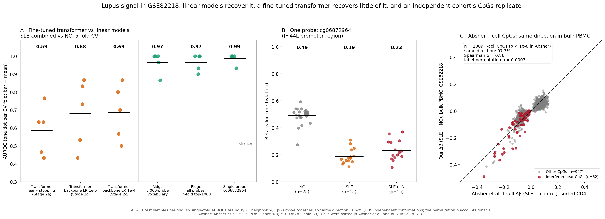

# Project 8 — Lupus (SLE) Methylation: Does a Cancer-Trained Model Already Know Lupus, and What Is the Signal Made Of?

## Biological Question

Does a methylation transformer trained on cancer already encode lupus, and what is the lupus
methylation signal in blood made of?

## Dataset

**GSE82218** (UT Southwestern; PBMC DNA methylation on the Illumina HumanMethylation450 array).
55 samples: 25 normal controls (NC), 15 SLE without nephritis, 15 SLE with lupus nephritis
(SLE+LN). Primary comparison: SLE-combined (n = 30) vs. NC (n = 25), fixed in advance. Ages
10–46 (mean 32.2 NC, 29.1 SLE-combined; 4 of 55 under 18); 20 of 25 NC and 26 of 30
SLE-combined samples are female. No patient identifier exists; the cohort appears to be one
sample per patient.

## What I Built

* A zero-shot probe of a cancer-trained methylation transformer (from my Project 6) on lupus.
* A full fine-tuning study under nested cross-validation, then a diagnostic retry.
* Linear baselines on the same folds that show where the signal lives.
* An interferon gene-set enrichment test, a STRING interaction-module test and a probe-level
  look at mixed-direction loci.
* An independent replication against the published Absher et al. 2013 CpG tables, plus an
  exploratory composition probe.
* Every claim comes with its null model, its limitations and the analyses that did not work.

## Key Result

| Question | Answer |
|---|---|
| Does the cancer-trained transformer separate SLE from healthy zero-shot? | No (CV accuracy 0.600 ± 0.136 vs. 0.545 majority baseline; 3-class 0.455 = baseline) |
| Can full fine-tuning recover the signal from 55 samples? | Only weakly: mean AUROC 0.59, 0.68 and 0.69 across three recipes |
| Is the signal in the model's input? | Yes: ridge on the same 5,000 probes reaches AUROC 0.967; one probe (cg06872964) reaches 0.987 |
| What is the signal? | Promoter-proximal hypomethylation at 25 of the 97 Hallmark IFN-alpha genes (p < 0.0001 against a context-matched null), forming one connected STRING module (34 of 64 genes) |
| Does it replicate independently? | Yes in direction: 97.3% of 1,009 T-cell CpGs from Absher et al. 2013 agree (label-permutation p = 0.0007, rank rho 0.86) |

In one sentence: the lupus signal is large and sits mostly at interferon-stimulated genes, a
linear model finds it easily, and the transformer I fine-tuned recovers little of it at this
sample size. These are correlational results on 55 samples; the limitations sections below
say what they do not show.

---

## Stage 1 — Zero-Shot Probing: Does a Cancer-Trained Model Already Know About Lupus?

### Biological/ML Question

Does a methylation transformer trained exclusively on cancer epigenetic
dysregulation (5 TCGA classes: BRCA, PRAD, LUAD, COAD, Normal) already
separate systemic lupus erythematosus (SLE) from healthy PBMC methylation,
with **zero lupus-specific training**? If the pretrained embedding space
already encodes something disease-relevant, that's a strong "foundation
models generalize across disease domains" finding. If not, that's a real
result too -- it motivates fine-tuning as a genuine next step rather than
an assumed one.

### Dataset

**GSE82218** (UT Southwestern, PBMC DNA methylation, Illumina
HumanMethylation450 -- same platform as the Project 6/7 TCGA cohort):

| Group | n |
|---|---|
| Normal Control (NC) | 25 |
| SLE (no nephritis) | 15 |
| SLE + Lupus Nephritis (SLE+LN) | 15 |
| **Total** | **55** |

Age range 10-46 years -- note this cohort includes pediatric patients
(ages 10, 12, 13, 17, 18 all present), unlike the adult-only TCGA cohort
this project's zero-shot model was trained on. Worth keeping in mind as a
population difference, not just a disease-domain difference.

**Primary comparison, decided in advance (not chosen post-hoc):**
SLE-combined (SLE + SLE+LN, n=30) vs. NC (n=25). The 3-way split is
reported as exploratory only, per the small-N framing decided at project
kickoff.

### What I Built

1. Parsed GSE82218's Series Matrix File directly (processed beta values
   are included in the sample data table -- no separate normalization
   pipeline needed, matching the approach used for TCGA's SeSAMe files
   in Project 6).
2. Subset and reordered GSE82218's 485,577 probes to the **exact 5,000-probe
   vocabulary** the Project 6 transformer was trained on, preserving
   column order (order matters -- the model's input positions are
   probe-specific, not just probe-agnostic features). **Result: 5,000/5,000
   probes found, full overlap** -- no platform-compatibility confound
   going into the zero-shot test.
3. Found and mean-imputed 192 NaN beta values (0.07% of the matrix, 144
   probes, 54/55 samples affected, spread proportionally across all three
   groups) before running the model -- see Known Issues below.
4. Loaded the verified Project 6 `MethylationTransformer` checkpoint
   (`best_transformer.pt`), ran all 55 samples through in `return_embedding=True`
   mode to get 128-dim CLS embeddings, no fine-tuning.
5. UMAP visualization of the embeddings, colored by group.
6. **Quantified the separation formally** rather than relying on the UMAP
   plot alone: 5-fold stratified cross-validated logistic regression on
   the raw embeddings, predicting group, compared against a majority-class
   baseline.

### Known Issues Encountered This Stage

**Full self-attention over 5,001 tokens (5000 CpG + CLS) is memory-expensive
even at inference, even with only 55 samples.** A single forward pass over
all 55 samples attempted to allocate ~22GB (`55 x 4 heads x 5001^2 x 4 bytes`),
failing on `compbio`'s CPU-only, ~6.2GB budget -- the same constraint
`methylation_model.py`'s own docstring warns about for *training*, which
turned out to apply to inference too, since attention memory cost is driven
by sequence length, not batch size. **Fix: batch size 4** (roughly
4 x 400MB = 1.6GB peak), matching the batching approach Project 6's own
`09_attractor_analysis.py` used (`DataLoader(..., batch_size=32)` on GPU;
4 was chosen here for a smaller CPU budget).

**192 NaN values in the source beta matrix** (0.07% of cells, 144/5000
probes, 54/55 samples) -- individual probes occasionally fail QC on
individual array chips. Confirmed the missingness was sparse and spread
proportionally across all three groups (not concentrated in one group,
which would have suggested a batch/quality confound correlated with
disease status) before choosing per-probe mean imputation as a low-risk
fix over dropping the 144 affected probes entirely.

### Key Result — Clean Negative

| Comparison | Logistic regression CV accuracy | Majority-class baseline | Difference |
|---|---|---|---|
| **SLE (combined) vs. NC** (primary) | 0.600 (+/- 0.136) | 0.545 | +0.055 |
| NC / SLE / SLE+LN (exploratory) | 0.455 (+/- 0.057) | 0.455 | +0.000 |

**A model trained exclusively on cancer epigenetic dysregulation does not
zero-shot separate lupus from healthy PBMC methylation.** The primary
comparison's +0.055 improvement over baseline is well within its own
cross-validation noise (+/- 0.136 std, more than double the effect size)
-- not distinguishable from the classifier having learned nothing. The
3-class comparison shows literally zero improvement over always guessing
the majority class.

This is consistent with the UMAP visualization: NC, SLE, and SLE+LN
samples are thoroughly intermixed throughout the main embedding structure,
with no visually apparent grouping by disease status.

**One structural feature in the UMAP plot -- a small, tight 6-point
subcluster -- does NOT correspond to disease group** (it contains a mix
of all three labels). Checked against the two other variables available
(age, sex): neither showed a clear association (mean age 29.4 vs. 31.5
across the split; no obvious sex skew). **Honestly unexplained** -- most
plausibly a technical/batch signal not captured in this dataset's
available metadata, but that is a plausible guess, not a demonstrated
finding.

### Interpretation

A model trained only on cancer epigenetic dysregulation does not zero-shot separate lupus
from healthy PBMC methylation, and its CLS embedding discards the lupus signal: Stage 2
shows that a linear model on the same 5,000 raw probes reaches AUROC ~0.97, so the signal
is present in the input. What this stage supports is therefore narrow: the Project 6
embedding does not preserve it. It does not show that cancer and autoimmune methylation
require different features, or that the signal is unrecoverable from this input.

### Figure

`figures/gse82218_zeroshot_umap.png`

### Files

- `scripts/01_parse_series_matrix.py` -- metadata parsing + alignment check
- `scripts/02_parse_beta_matrix_and_subset.py` -- full beta matrix parse,
  subset to Project 6's 5000-probe vocabulary
- `scripts/02b_impute_missing_values.py` -- per-probe mean imputation
- `scripts/03_zeroshot_embed_and_umap.py` -- embedding extraction + UMAP
- `scripts/04_quantify_separation.py` -- cross-validated separation test
- `data/gse82218_zeroshot_input_imputed.parquet` -- final model-ready input
- `data/gse82218_zeroshot_embeddings.npz` -- raw 128-dim embeddings + metadata

---

## Stage 2 — Fine-Tuning and Linear Baselines: The Signal Is in the Input; the Transformer Does Not Extract It

### Biological/ML Question

Stage 1 found that the Project 6 methylation transformer, used zero-shot,
does not separate SLE from healthy PBMC methylation. Stage 2 asks two
things: (1) can full end-to-end fine-tuning on GSE82218 recover the signal,
and (2) is the signal actually present in the model's 5,000-probe input in
the first place? Question (2) turned out to be the more informative one.

### What Was Run

All experiments use the same outer evaluation: 5-fold `StratifiedKFold`
(seed 42) on the 55 GSE82218 samples, primary comparison SLE-combined (n=30)
vs. NC (n=25), metric AUROC. Each outer test fold holds about 11 samples.

1. **2a — Fine-tuning with early stopping** (`05_finetune_transformer_cv_colab.py`).
   Full fine-tune of the Project 6 transformer (new 2-class head; backbone LR
   1e-5, head LR 1e-3), nested CV with an inner validation split for early
   stopping. A first attempt on CPU was killed by the OS (out of memory):
   backpropagation keeps every layer's 5,001 x 5,001 attention activations,
   which exceeds the ~6 GB budget, so this ran on a Colab GPU.
2. **2b — Linear baselines** (`06_linear_baseline_cv.py`), same folds:
   (a) L2-regularized logistic regression on the 5,000-probe vocabulary;
   (b) the same on all probes, with the top 1,000 chosen by t-test **inside
   each training fold only**; (c) a single probe, cg06872964 (an IFI44L
   promoter probe chosen from prior literature before looking at any
   labels). A first version used an elastic-net penalty with the `saga`
   solver and was abandoned after about 30 minutes without finishing a fold;
   it was replaced with L2 + `lbfgs`. (The function is still named
   `elastic_net` in the code for minimal diff; the model is L2.)
3. **2c — Transformer diagnostic retry** (`06b_transformer_diagnostic_colab.py`).
   No early stopping, fixed 30 epochs, no inner split, only final-epoch test
   AUROC reported, training loss and AUROC logged. Two configurations
   declared in advance and both reported (backbone LR 1e-5 and 1e-4).

### Results

| Model | Fold-mean AUROC | Notes |
|---|---|---|
| 2a Transformer, fine-tuned with early stopping | 0.587 +/- 0.122 | best epoch was often epoch 1-2 |
| 2c Transformer, config A (backbone LR 1e-5) | 0.680 +/- 0.169 | train loss 0.67-0.74 at epoch 30 |
| 2c Transformer, config B (backbone LR 1e-4) | 0.687 +/- 0.138 | train loss 0.65-0.77 at epoch 30 |
| 2b(a) L2 logistic regression, 5,000-probe vocabulary | **0.967 +/- 0.052** | pooled out-of-fold AUROC 0.959 |
| 2b(b) L2 logistic regression, all probes, in-fold top-1000 | 0.967 +/- 0.042 | pooled out-of-fold AUROC 0.969 |
| 2b(c) single probe cg06872964 | 0.987 +/- 0.027 | pooled out-of-fold AUROC 0.991 |

3-class (NC / SLE / SLE+LN) fine-tuning collapsed to predicting the
majority class (NC) in all five folds (accuracy 0.4545 = 25/55). It is
reported as exploratory only and was not pursued further.

### Findings

* **The lupus signal is present in the model's input.** A linear model on
  the same 5,000 probes reaches ~0.97 AUROC, and in-fold selection from all
  485,577 probes adds nothing. Probe cg06872964 alone separates the groups
  (mean beta 0.49 in NC vs. 0.19 in SLE and 0.23 in SLE+LN; AUROC 0.009 on
  raw beta, i.e. 0.991 with the direction flipped), in the direction
  predicted by interferon-pathway hypomethylation.
* **The transformer does not extract it.** The zero-shot CLS embedding
  discards the signal (Stage 1), and fine-tuning recovers only a weak part
  of it (~0.68). The transformer scored below ridge on every one of the 10
  fold comparisons (5 folds x 2 configs).
* **The diagnostic points to under-fitting, not memorization.** Training
  loss stayed near ln 2 (0.693, the loss of a guessing model) and training
  AUROC after 30 epochs ranged only from 0.70 to 0.89.
* **Stage 2a's score was uninformative.** Early stopping on ~9 validation
  samples frequently selected epoch 1-2, i.e. a nearly untrained model, and
  inner-validation and outer-test scores did not track each other.
* **Do not read 0.68 vs. 0.587 as an improvement.** With ~11-sample test
  folds, the null SD of a single fold's AUROC is ~0.18 (~0.08 for the
  five-fold mean); the difference is within noise, and configs A and B are
  indistinguishable.

**Untested hypothesis for the mechanism:** the lupus signal is concentrated
in a few probes among 5,001 tokens; the CLS token's attention starts near
uniform, diluting any single probe's contribution, and the Project 6
weights were shaped to extract tissue-identity features. This is consistent
with the results but was not directly tested.

### Confound Checks and Remaining Limitations

* **Sex:** NC 20F/5M, SLE-combined 26F/4M. Too balanced to explain the effect.
* **Age:** mean 32.2 (NC) vs. 29.1 (SLE-combined) years, SD 8-9, overlapping
  ranges; 1 of 25 NC and 3 of 30 SLE samples are under 18. Too small a gap
  to explain the effect.
* **Not checkable with available metadata:** PBMC cell-type composition
  (SLE shifts neutrophil/lymphocyte proportions, which alone can change bulk
  methylation) and batch (the unexplained 6-sample cluster from Stage 1 may
  be a batch effect). The separation should not be attributed purely to
  within-cell interferon biology until this is addressed; Absher et al. 2013
  gene lists are the planned external check in Stage 3.
* **n = 55** with ~11-sample test folds: all AUROCs are noisy and the
  between-fold SDs are wide.
* **Number of transformer configurations tried: 3** (Stage 2a, 2c-A, 2c-B),
  all on the same folds. No further tuning was done, to avoid best-of-N
  selection on 55 samples.
* Probe cg06872964 (IFI44L promoter region) was chosen from prior literature before any labels were examined; it is listed in Absher et al. 2013, Table S3 (see Stage 3).

### Files

* `scripts/05_finetune_transformer_cv_colab.py` and `results/stage2_finetune_cv_results.json`
* `scripts/06_linear_baseline_cv.py` and `results/stage2b_linear_baseline_results.json`
* `scripts/06b_transformer_diagnostic_colab.py` and `results/stage2c_transformer_diagnostic_results.json`

---

## Stage 3 — What Is the Signal Made Of? Interferon Enrichment, an Interaction Module, and Independent Replication

### Biological/ML Question

Stage 2 showed that a linear model recovers the lupus signal in GSE82218 (AUROC ~0.97)
while a fine-tuned transformer recovers little of it. Stage 3 asks what that signal
consists of, whether it is biologically coherent, and whether it replicates in an
independent cohort.

### What Was Run

All permutation tests use 10,000 draws with seed 42. Primary tests were declared in the
script docstrings before any result was seen; everything else is labelled secondary or
exploratory.

| Script | Purpose |
|---|---|
| `07_annotate_stable_probes.py` | Attach genes (Zhou lab HM450 hg38 table, GENCODE v41) to the 460 probes selected in the top 1,000 by in-fold t-test in all five Stage 2b folds |
| `08_probe_direction.py` | Direction and size of the group difference per stable probe |
| `09_ifn_enrichment_permutation.py` | Hallmark IFN-alpha gene-set enrichment, context-matched probe permutation |
| `10_hyper_gene_inspection.py` | Probe-level look at genes covered by the hypermethylated probes (descriptive) |
| `11_string_module_coherence.py` | Largest connected component of the STRING v12.0 subgraph, degree-matched null |
| `12_kegg_node_check.py` | Which module genes are nodes in four KEGG pathways |
| `13_string_module_figure.py` | Module figure |
| `14`–`16_*absher*.py` | Parse Absher et al. 2013 Tables S3/S4 and test replication in GSE82218 |
| `17_composition_probe.py` | Exploratory intermediate-beta probe |
| `18_summary_figure.py` | Three-panel summary figure |

### Results

**The stable set.** 460 probes: 116 hypomethylated and 344 hypermethylated in
SLE-combined vs. NC. The median |delta beta| is 0.085. The largest shifts are all
hypomethylation at interferon-pathway loci (MX1 -0.489; DTX3L/PARP9 -0.414; IFI44L -0.366;
CMPK2/RSAD2 -0.344). Probes were ranked by delta beta, not t, because the t-statistics are
circular (probes were chosen for large |t|). Of the hypomethylated probes, 91 of 116 (78%)
are promoter-proximal (within 1.5 kb of a transcription start site), against 152 of 344
(44%) of the hypermethylated probes and 57% of the eligible pool; this contrast was
noticed after looking and was not tested.

**Interferon enrichment (primary tests, matched null, alpha = 0.025).**

| Subset | Probes | Distinct Hallmark IFN genes observed | Null mean (95th percentile) | p |
|---|---|---|---|---|
| Hypomethylated | 116 | 25 of 97 | 0.63 (2) | < 0.0001 (floor of the test) |
| Hypermethylated | 344 | 6 | 1.46 (4) | 0.0063 |
| All 460 (secondary) | 460 | 28 | 2.04 (5) | < 0.0001 |

The null draws random probe sets matched to the observed numbers of promoter-proximal,
other-gene and no-gene probes. The hypermethylated signal is weak: 3 of its 6 genes
(EPSTI1, HELZ2, LGALS3BP) are also covered by hypomethylated probes. Probe-level
inspection shows mixed-direction loci: EPSTI1, OAS2 and LGALS3BP have a
promoter-proximal hypomethylated probe plus an opposite-direction probe outside
promoters (a post hoc observation in four genes); HELZ2 has four promoter-flagged probes
that split 1 hypo to 3 hyper (the flag means near any transcript's start site, so isoforms
may explain this; untested).

**The two-arm hypothesis from the plan.** All four IRF7 probes are hypomethylated and
promoter-proximal. The single USP18 probe is also hypomethylated (-0.247, not
promoter-proximal), so "epigenetic silencing of the negative regulator" is not supported
by this probe. SOCS1 is not in the stable set, which does not mean it shows no difference.

**Interaction module (STRING v12.0).** The hypomethylated genes (72 symbols, 64 in STRING)
form one connected component of 34 genes at combined score >= 700, against a
degree-matched null mean of 2.6 (95th percentile 4), p < 0.0001. It holds at score >= 400
(41 vs. 6.5, 95th percentile 12), >= 900 (26 vs. 1.8, 95th percentile 3) and with
experimental or curated-database evidence only (9 vs. 2.2, 95th percentile 3). The module
contains 24 of the 25 Hallmark genes among the hypomethylated set plus 10 others (IFIT1,
DDX58, OAS2, OAS3, XAF1, IFIT5, TRIM22, DTX3L, DDX60L, NLRC5), and includes IRF7 and
USP18. Without the 97 Hallmark genes, the remaining 39 still cluster at score >= 700 (9
vs. 1.7, 95th percentile 3, p < 0.0001) but only marginally under experimental or curated
evidence (3 vs. 1.6, 95th percentile 3, p = 0.053). The hypermethylated set (251 genes in
STRING) gives 43 vs. 13.7 (95th percentile 26, p = 0.0006) at >= 700 and 38 vs. 20.9
(95th percentile 39, p = 0.066) under stricter evidence; it was not examined further.
The 10 extra module genes are interferon-stimulated genes by background knowledge; this
was not tested against another gene set.

**Directed-pathway analysis (dropped).** The plan called for betweenness centrality in a
directed interferon network. Four KEGG pathways were checked for module-gene membership:
JAK-STAT (hsa04630, 168 genes) contains none; RIG-I-like receptor signaling (hsa04622, 72
genes) contains IRF7 and TRIM25; cytosolic DNA-sensing (hsa04623, 83 genes) contains IRF7;
SLE (hsa05322, 141 genes) contains none. The module consists mostly of end-of-cascade
effector genes that these pathways do not encode as nodes, so betweenness could not be
computed meaningfully. Reactome was not checked. Integrated gradients and TOMTOM motif
analysis were dropped along with the transformer.

**Independent replication (Absher et al. 2013, Table S3).** Absher et al. profiled sorted
CD4+ T-cells, CD19+ B-cells and CD14+ monocytes (49 SLE, 58 controls, 450K array). The parsed
table reproduces the abstract's counts for T-cells (1,033 CpGs at p < 1e-8) and B-cells
(166), **but not for monocytes (41 parsed vs. 97 reported; cause unresolved), so monocyte
analyses were excluded.** Direction of effect was compared in GSE82218 (SLE-combined minus
NC) against a null from 10,000 permutations of the SLE/NC labels (a naive binomial test is
anti-conservative because neighboring CpGs are not independent):

| Absher CpG set | Usable CpGs | Same direction | Null 95th percentile | Permutation p | Rank rho |
|---|---|---|---|---|---|
| T-cell, all (primary) | 1,009 | 982 (97.3%) | 91.1% | 0.0007 | +0.86 |
| T-cell, non-interferon | 947 | 923 (97.5%) | 91.3% | 0.0005 | +0.85 |
| T-cell, interferon-near | 62 | 59 (95.2%) | 96.8% | 0.090 | +0.84 (p = 0.006) |
| T-cell, excluding our stable-set CpGs | 918 | 891 (97.1%) | 90.7% | 0.0007 | +0.84 |
| B-cell (secondary) | 162 | 146 (90.1%) | 84.6% | 0.005 | +0.74 |

The interferon-near sign test lacks power because these CpGs share one axis of variation
(the null's 95th percentile is 96.8%); the rank correlation is the more informative
statistic there. The 1,009 concordant CpGs are not independent confirmations. Of our stable
probes, 83 of 116 hypomethylated and 18 of 344 hypermethylated ones appear in Table S3, and
Absher's T-cell direction matches ours for all 101. Probe cg06872964 is listed in Table S3
(IFI44L, interferon-flagged, T-cell delta -0.204), which independently supports its
use as the single a-priori probe in Stage 2.

**Composition probe (exploratory).** Absher et al.'s Figure S1 caption reports that their
significant non-interferon T-cell CpGs are enriched for intermediate beta values. In our
controls, the fraction of CpGs with mean beta in [0.2, 0.8] is 0.82 for Absher's
non-interferon T-cell CpGs vs. 0.63 for their interferon-near ones (difference +0.196,
shuffle p = 0.0008), and 0.77 for our hypermethylated vs. 0.68 for our hypomethylated
stable probes (difference +0.092, p = 0.065). Every set is far above its matched null,
which is expected from the bounded beta range alone. This is consistent with, but not
evidence for, a composition-driven component: bulk PBMC mixing and the bounded range both
predict the pattern. **Cell-type deconvolution was not performed.**

### Interpretation

The lupus methylation signal in GSE82218 is concentrated at interferon-stimulated genes:
promoter-proximal hypomethylation at 25 of the 97 Hallmark interferon-response genes, which
form one connected STRING module and which agree in direction with an independent cohort of
sorted cells. A larger, weaker, more mixed hypermethylated remainder also agrees in
direction with Absher et al., is only modestly interferon-enriched, and may reflect cell
composition (untested). These data are correlational and cannot say whether the
hypomethylation causes or follows interferon exposure.

For liquid-biopsy work, the relevant point is that a methylation signature driven by
interferon-pathway inflammation exists in blood cells and is large; whether it affects
cfDNA classifiers in patients with autoimmune or inflammatory disease is a hypothesis this
project did not test.

### Limitations

* n = 55 samples with ~11 per test fold. The 460 stable probes are a discovery set
  (selection effectively used all samples); no performance figure is claimed from them.
* Gene counts double-count shared probes: PARP9/DTX3L, TRIM5/TRIM22 and CMPK2/RSAD2 have
  fully shared stable probes, so the 34-gene module is about 31 independent loci.
* STRING edges include co-expression and text mining and reflect co-study bias; degree is
  not importance.
* GSE82218 is bulk PBMC; Absher et al. used sorted cells and a different cohort.
* No SNP or cross-reactive probe masking was applied in the full-matrix analyses
  (Stages 2b-3); the Zhou lab masks exist but were not used.
* Many analyses were run; primary tests are declared, everything else is secondary or
  exploratory, and there is no global multiplicity correction.
* Monocyte counts in Table S3 do not match the abstract (unresolved); Reactome and
  cell-type deconvolution were not examined.

### Figures

* `figures/stage3_summary_panels.png` — model comparison, cg06872964 by group, Absher replication
* `figures/stage3_string_module.png` — the 34-gene STRING module (color = delta beta of the most extreme stable probe; descriptive; layout is arbitrary)

### Data and Citations

GSE82218 (this project); STRING v12.0 (human); MSigDB Hallmark gene sets (Liberzon et al.
2015, PubMed 26771021, CC-BY-4.0); Zhou, Laird and Shen 2017, *Nucleic Acids Research*
(HM450 annotation); Absher et al. 2013, *PLoS Genetics* 9(8):e1003678 (Tables S3/S4);
KEGG REST (pathway membership check only).

---

## Methods (Brief)

* **Input:** processed beta values from the GEO series matrix. 192 NaN cells (0.07%) were
  mean-imputed per probe for the transformer input (spread proportionally across groups). Linear
  analyses on the full matrix dropped probes with any NaN (471,758 of 485,577 remain).
* **Vocabulary:** the transformer's 5,000-probe vocabulary comes from my Project 6 (all 5,000
  present in GSE82218).
* **Evaluation:** 5-fold `StratifiedKFold` (seed 42) for every model so scores are comparable.
  Transformer fine-tuning used nested CV with an inner split for early stopping (Stage 2a) or a
  fixed 30-epoch recipe with no model selection (Stage 2c).
* **Nulls:** probe-level permutations matched on genomic context (enrichment), degree-matched
  random gene sets (module), and SLE/NC label permutations (replication). 10,000 draws, seed 42.
* **Transformer:** each CpG is one token (a learned probe embedding plus a linear projection of
  its beta value) with a CLS token, 4 layers, d_model 128, 4 heads. Full self-attention over
  5,001 tokens exceeds a 6 GB CPU budget for training, so Stage 2 ran on a Colab GPU.
* **Sample grouping:** no patient identifier exists; no duplicated patients were found at Stage 1.

## How to Run

Environment: Python 3.10 (conda env `genomics-ml`); packages are listed in `requirements.txt`.
Stage 2's `*_colab.py` scripts need a GPU runtime and Google Drive paths. Scripts use relative
paths (`../data/`), so run them from `scripts/`.

1. **Stage 1 (CPU):** `01` → `02` → `02b` → `03` → `04`. Needs the GSE82218 series matrix from
   GEO and the Project 6 checkpoint (`best_transformer.pt`) and probe list.
2. **Stage 2:** `05_finetune_transformer_cv_colab.py` and `06b_transformer_diagnostic_colab.py`
   on Colab; `06_linear_baseline_cv.py` on CPU.
3. **Stage 3 (CPU):** `07` → `08` → `09` → `10`; STRING v12.0 files for `11`/`13`; the Hallmark
   gene set for `09`; the Zhou lab HM450 annotation for `07`; Absher et al. Tables S3/S4 for
   `14`–`17`; then `18` for the summary figure.

Large inputs and intermediate files under `data/` are not committed. The small result files are
copied to `results/`.

## Files

* `scripts/` — all analysis scripts, numbered in run order (`methylation_model.py` is copied from
  Project 6)
* `figures/` — `stage3_summary_panels.png`, `stage3_string_module.png`, `gse82218_zeroshot_umap.png`
* `results/` — `stage2_finetune_cv_results.json`, `stage2b_linear_baseline_results.json`,
  `stage2c_transformer_diagnostic_results.json`, `stage3_ifn_enrichment_results.json`,
  `stage3_string_module_results.json`, `stage3_absher_replication_results.json`,
  `stage3_composition_probe_results.json`, `stable_probes_direction.tsv`,
  `stage3_string_module_genes.tsv`
* `requirements.txt`, `.gitignore`
